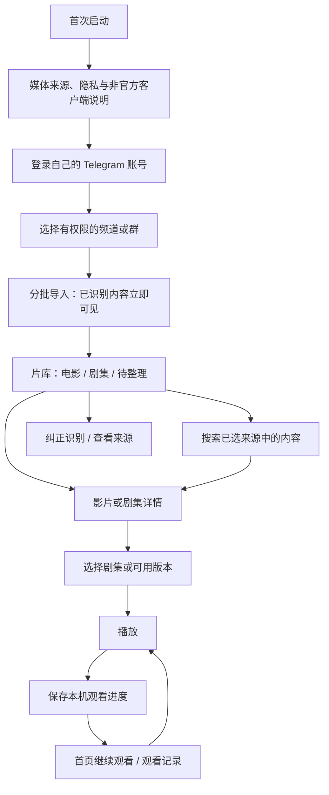

# TG Cine 产品设计方案

状态：用户已确认（2026-10-12）。本文描述目标产品和页面蓝图，不代表功能已实现。

## 1. 产品定位与已选决策

TG Cine 是面向所有用户的开源个人影视播放器，使用用户自己的 Telegram 账号可访问的频道或群作为媒体来源。核心闭环是：找片或选集 → 播放 → 下次继续观看。以 App Store 公开发行作为设计目标，首发面向海外地区，不含中国大陆；具体国家或地区在发行准备阶段确定。

| 决策 | 已选方向 |
| --- | --- |
| 客户端与界面 | Flutter/Dart、ForUI、中文；手机与宽屏同步设计，不限制平台 |
| 媒体入口 | 用户选择已有访问权限的频道或群 |
| 内容组织 | 电影、剧集归类；保留待整理条目、源消息与人工纠正 |
| 服务体验 | 只提供默认中转服务，用户无需填写服务地址或访问令牌 |
| 使用资格 | 面向所有用户，取消邀请码准入；默认服务授权在后台完成 |
| 影视资料 | 允许联网补全海报、简介和季集信息，匹配不确定时保留原始信息 |
| 历史导入 | 分批导入，可边整理边使用；应用运行时继续，支持暂停和恢复 |
| 续看范围 | 首版本机保存观看进度，跨设备同步后续再做 |
| 首页结构 | 方案 B：顶部继续观看、海报片库；宽屏并排预览详情，手机进入详情页 |
| 本轮交付 | 完整产品方案与页面蓝图，不制作高保真原型或实现业务代码 |
| App Store 首发 | 面向海外地区，不含中国大陆；公开发行条件需在实施与提交前验证 |

默认服务的部署、开放和网络可达性需要单独验证与授权。当前 Worker 仍只提供健康检查和入口校验，合法中转请求也返回 `501 TUNNEL_NOT_IMPLEMENTED`。

## 2. 产品体验原则

- **观看优先。** 已有记录时，一次点击进入续看；电影和剧集均从真实可访问媒体产生播放入口。
- **来源透明。** 每个可播放版本都能追溯到来源及原消息；影视资料匹配不会改变媒体本身。
- **渐进可用。** 导入完成一部分就展示一部分，不等待扫描完所有历史；真实计数未知时不显示虚构百分比。
- **错误可恢复。** 失败说明原因并提供当前可执行的操作，保留已导入资料、人工纠正和本机观看记录。
- **两种屏幕，同一任务。** 随可用窗口宽度改变导航和信息分栏，手机与宽屏具有一致的信息、操作和状态。

主应用采用 Impeccable 的 Operate 模式，帮助用户完成观看任务；播放器减少界面干扰，让媒体成为主角。沿用现有 ForUI neutral 明暗主题、中文文案与 Lucide 图标，不在本轮另建品牌视觉体系。

## 3. 信息架构与使用路径

顶层目的地为 **片库、观看记录、来源、设置**。搜索属于片库操作；影片详情、季集选择和播放器属于内容层级。



首次使用按产品说明、Telegram 登录、来源选择递进，保留已完成步骤；后续启动进入片库，并恢复本机的来源选择、筛选和浏览位置。默认服务连接及必要授权在后台进行，失败时显示对应状态。

Telegram 登录用于访问自己的媒体；界面不新增独立的用户名和密码账号体系。默认服务保留鉴权、请求限流和内存保护，具体协议与容量需要单独验证；用户端不展示服务令牌配置。

## 4. 页面蓝图

| 页面 | 主要内容与操作 | 手机 | 宽屏 |
| --- | --- | --- | --- |
| 首次启用 | 媒体与隐私说明、Telegram 登录、来源选择、首次导入进度 | 分步全页，键盘和安全区域不遮挡操作 | 居中流程区，旁边展示当前步骤说明 |
| 片库 | 搜索、继续观看、电影/剧集/待整理、来源筛选、海报网格、导入状态 | 底部导航；网格点入详情 | 侧栏导航；片库与详情预览并排 |
| 搜索 | 已选来源内按片名、原文件名等检索；结果说明匹配信息与来源 | 独立搜索页，返回保留片库位置 | 片库内搜索，结果仍可在旁栏预览 |
| 电影详情 | 真实标题、海报和简介、来源、可用版本、播放/继续播放、纠正资料 | 滚动详情页，主操作清晰可达 | 详情预览支持直接播放，也可展开完整详情 |
| 剧集详情 | 剧集介绍、季选择、已导入剧集、观看进度、版本选择 | 季选择与剧集列表纵向排列 | 剧集列表与选中集的信息并排 |
| 播放器 | 播放暂停、进度、音量、全屏、可用字幕/音轨、选集、退出 | 沉浸式播放；按系统和用户操作处理横竖屏 | 保持影片画幅，控制区和选集区按需展开 |
| 观看记录 | 本机记录、继续观看、已看完状态、移除单条/清空本机记录 | 按时间纵向排列 | 列表与选中内容的信息并排 |
| 来源 | 来源名称、导入状态与计数、最近同步、暂停/恢复、添加/移除、隐藏或举报 | 来源列表进入各自详情 | 来源列表与导入详情并排 |
| 待整理/纠正 | 原文件名与缩略图、来源、资料候选、类型和季集纠正 | 从片库进入，逐条确认 | 原信息与候选资料并排比较 |
| 设置 | Telegram 账号与断开连接、默认服务状态、本机数据清理、资料补全偏好、隐私政策、反馈与联系、主题、关于 | ForUI 分组列表 | 同样分组，限制阅读宽度 |

未接入的能力不能显示成已连接、已完成或可播放。以后制作原型时，示例内容需明确标注为设计数据。

### 片库首页：手机

```text
┌──────────────────────────┐
│ TG Cine             搜索 │
│ 继续观看 · 本机          │
│ [缩略图 / 进度 / 续看]   │
│ 电影  剧集  待整理       │
│ 全部来源 ▾    排序 ▾     │
│ [海报]       [海报]      │
│ 标题 / 年份  标题 / 年份 │
│ [海报]       [海报]      │
│ 已导入内容 / 查看进度    │
├──────────────────────────┤
│ 片库  记录  来源  设置   │
└──────────────────────────┘
```

没有观看记录时隐藏续看区；还未选择来源时展示“选择来源”的引导。已选择来源但没有媒体、正在导入、资料识别失败分别使用不同状态说明。

### 片库首页：宽屏

```text
┌────────┬────────────────────────┬──────────────────┐
│TG Cine │ 搜索                   │ 内容详情预览     │
│片库    │ 继续观看 · 本机        │ 海报 / 标题      │
│记录    │ 电影  剧集  待整理     │ 简介 / 来源      │
│来源    │ 来源筛选 / 排序        │ 选季 / 选集      │
│设置    │ [海报] [海报] [海报]   │ 可用版本         │
│        │ [海报] [海报] [海报]   │ 播放 / 继续播放  │
│        │ 导入状态 / 查看进度    │ 查看来源 / 纠正  │
└────────┴────────────────────────┴──────────────────┘
```

单击内容更新详情预览，播放需要明确的播放操作；选中态、键盘焦点和正在播放状态分别表达。返回片库恢复内容选择与滚动位置。

### 影片详情与播放器

详情按标题 → 简介 → 实际可用剧集或版本 → 主播放操作 → 来源与纠正组织。多个版本展示能从媒体中确认的信息，如文件名、来源、大小或时长；未知信息显示未知，不猜测清晰度。

已有进度时主操作为“继续播放”，另提供“从头播放”。剧集只为已导入且可访问的媒体提供播放入口；资料服务列出的集数不等于本机已有媒体。播完显示下一集操作，默认不自动跳集。

播放器默认隐藏非必要信息，操作或聚焦时显示控件。拖动进度给出反馈；退出保存实际播放位置并返回原浏览上下文。字幕和音轨入口只在存在可用内容时展示，不承诺任意编码或外部字幕自动发现。

## 5. 响应式与交互约束

以下宽度区间为设计起点，最终随内容最小宽度及字体缩放验证调整，不表示代码已设置断点。

| 可用窗口宽度 | 导航与内容 |
| --- | --- |
| 小于 600dp | 底部四目的地导航；网格进入独立详情；播放器独立展示 |
| 600–1023dp | 导航栏收为窄侧栏；增加网格列数；空间不足时详情仍单独展示 |
| 1024dp 及以上 | 侧栏、片库、详情分栏；各内容区能独立滚动 |

海报网格根据可用空间决定列数；大字体下减少列数或切换列表，不压缩文字。保留系统安全区域、键盘避让、48dp 点击区域、明暗主题、减少动态效果偏好和平台返回行为。宽屏支持键盘导航、可见焦点及播放器快捷操作；手机操作不依赖悬停。

播放区保持原画幅，不为填满屏幕默认裁切内容。详情及来源中的长标题、长文件名可展开阅读。缩小窗口时保持当前来源、内容选择及播放进度。

## 6. 媒体整理与数据边界

- **来源与媒体。** 只导入用户主动选择、当前账号有权限的来源。媒体记录关联来源、原消息和文件，便于识别重复扫描和权限变化。
- **电影与剧集。** 一个影视条目可以关联多个媒体版本；一集可以有多个版本。删除一个来源的本机关联不能误删其他来源的版本。
- **识别与纠正。** 资料匹配不确定时进入待整理；原文件仍可按实际能力播放。人工纠正优先，后续导入不得静默覆盖。
- **资料补全。** 海报或简介获取失败时回退到 Telegram 原始信息；资料服务故障不应阻断已经可用媒体的播放。用户可关闭补全并了解会发送哪些检索信息。
- **观看进度。** 以账号和实际媒体版本保存本机进度，避免错接到另一版本或另一个账号。切换版本不会静默套用不一致的时间轴。
- **来源移除。** 说明仅移除本机片库关联，不操作 Telegram 原消息；受影响的记录保留“来源已移除”说明和清理入口。
- **会话与服务凭据。** Telegram 会话留在客户端；默认服务凭据单独管理。客户端不能以内置共享 `RELAY_TOKEN` 作为可靠的用户鉴权方案。服务端日志、用量、数据保留及删除规则需明确披露。

导入批次大小、资料匹配服务、去重规则、公共服务设备授权协议、存储实现均待技术方案确认，本轮不指定新依赖或修改 Worker 契约。具体来源数量和媒体规模尚未提供，设计须支持逐步加载，实际容量后续用代表性数据验证。公共服务的用量政策及运营成本需另行评估，不承诺无限使用。

## 7. 必须设计的状态与恢复操作

| 状态 | 界面反馈与下一步 |
| --- | --- |
| 默认服务不可用、请求受限 | 区分连接故障、维护和请求限制，提供重试或限制说明；不要求用户填写中转地址 |
| Telegram 登录失效 | 引导重新登录自己的账号；账号数据隔离，避免显示其他账号内容 |
| 未选择来源 | 解释片库如何产生，主操作为选择来源 |
| 来源中没有可导入媒体 | 说明已检查来源和结果，可选择其他来源 |
| 导入中、暂停或部分失败 | 显示真实已导入计数与当前状态，可查看详情、暂停、继续或重试失败部分 |
| 资料匹配不确定、海报加载失败 | 保留原始信息，提供纠正入口或缩略图回退 |
| 媒体失效、权限撤销或格式不支持 | 说明无法播放的具体原因，可返回、查看来源或选择其他版本 |
| 播放缓冲或中断 | 保留最近播放位置，提供恢复操作，不虚构连通成功 |
| 搜索无结果、无观看记录 | 说明当前检索范围或记录范围，提供清除筛选或返回片库的操作 |

失败反馈使用用户能理解的语言；错误码等技术详情放在可展开诊断中，诊断不包含验证码、会话或服务凭据。

## 8. 首版范围与后续阶段

首版设计覆盖默认服务自动连接、Telegram 登录、来源选择与导入、电影/剧集/待整理、搜索、详情与选集、基础播放、本机续看，以及默认服务故障恢复。公开发行需要的隐私、数据清理、内容反馈及联系入口纳入设计。

跨设备同步、离线下载、投屏、公开影视推荐、独立 TG Cine 账号注册与收费、云端保存 Telegram 会话不纳入首版。系统代理配置不出现在用户流程中；无需代理的实际可达性仍需实测。

实施可分为三步：先完成手机与宽屏的页面及真实状态骨架，再接入默认服务、Telegram 与导入能力，最后闭合播放与本机续看。每步均验证两种屏幕；未接入能力保持明确状态说明。

## 9. 设计验收与当前限制

后续原型及实现至少覆盖：首次启用、部分导入、正常片库、待整理、无结果、服务故障、媒体失效和续看。核对明暗主题、320dp 手机、常见手机宽度、中等宽度、1280dp 宽屏，以及字体放大后的可达性。

验收重点为：首次步骤可恢复；一个真实媒体能从来源找到、播放并再次续看；导入和资料补全失败可恢复；电影/剧集识别不会产生虚假播放入口；手机与宽屏具有一致的操作能力。

当前证据仅包括初始化源码、现有组件测试源码与旧手机截图，本轮未运行应用或测试。登录、资料匹配、真实中转、播放器、公共服务授权及本机进度均未实现；六个平台模板和本方案不代表六个平台已通过功能验收。

Impeccable 旧页面 brief 仍保留“手机优先”字样，平台字段和 DESIGN 侧车也需后续刷新。本方案按当前手机与宽屏同步约束编写；现有 `DESIGN.md` 继续记录已实现视觉，不用目标蓝图覆盖现状。

## 10. App Store 公开发行约束

核对日期：2026-10-12。以下为产品设计约束与待验证项，不能视为审核通过结论。

- **媒体与展示材料的权利。** 用户有来源访问权限不能代替影视版权授权。以合法个人媒体库定位，不内置未经授权的影视来源、海报或商店截图；需要准备第三方内容与资料使用依据。[Apple 审核准备说明](https://developer.apple.com/help/app-review/before-submitting-for-review/complete-review/)
- **内容与隐私。** 按可能适用的 1.2 准备过滤、举报处理、屏蔽及联系机制；按 5.1.1 提供隐私政策、断开 Telegram 授权和数据清理。仅访问第三方账号内容可能符合 4.8 客户端例外，但若扩展自有主账号须重新评估。具体适用范围待审核确认。[Apple 审核规范](https://developer.apple.com/app-store/review/guidelines/)
- **Telegram 接入条件。** 使用自己的 `api_id`，在介绍中说明非官方 API 客户端身份，不使用官方 logo。频道访问需支持官方赞助消息；有限功能媒体客户端与基本功能约束的适配需进一步确认，不先承诺无广告。[Telegram API 条款](https://core.telegram.org/api/terms)
- **可审核的实际功能。** 提交时默认服务须运行，准备可稳定审查的登录安排或适用的完整演示模式，并使用已获授权的示例媒体。不能用空页面或虚假演示遮盖真实功能缺失。[Apple 审核准备说明](https://developer.apple.com/help/app-review/before-submitting-for-review/complete-review/)
- **发行地区。** 首发已选海外地区，不含中国大陆；各目标地区的可用性与要求仍需评估。若后续增加中国大陆，需评估适用的 ICP 备案及相关文件。[Apple App 信息说明](https://developer.apple.com/help/app-store-connect/reference/app-information/app-information)

举报仅在用户主动提交并知悉用途时传送必要信息，不默认上传私密聊天内容。官方赞助消息的展示位置、公共服务授权与限流、具体影视资料服务及其授权、目标地区发行准备均为后续设计与技术验证事项。
